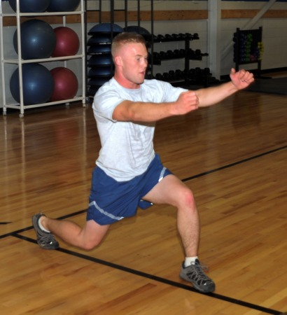
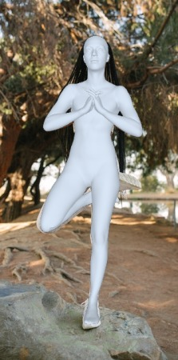
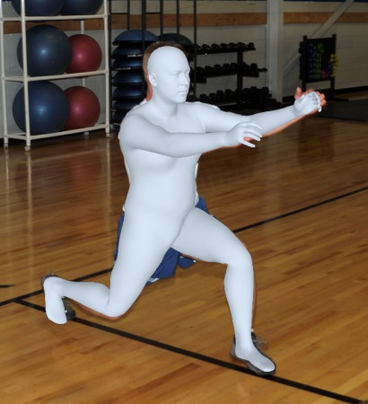
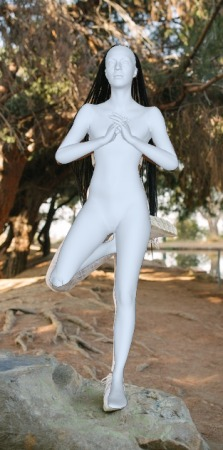

# SAM 3D Body Acceleration and Benchmarks

**English** · [简体中文](README.zh-CN.md)

This project builds on [Meta SAM 3D Body](https://github.com/facebookresearch/sam-3d-body) and [Fast SAM 3D Body](https://github.com/yangtiming/Fast-SAM-3D-Body) to speed up single-person 3D reconstruction and compare latency and output differences on the same inputs. It provides reusable TensorRT and compilation profiles, optimizations to the body decoder path, and a locally adapted **INT8 384** backbone. The desktop interface lets you switch profiles, warm up models, and inspect the results side by side.

On an RTX 4060 Laptop GPU with 8 GB of VRAM, **Fast INT8 384 averaged 41.71 ms per inference (43.53 ms P95)** with YOLO on every run. That is about **23% lower latency** than Fast FP16 384 at 53.99 ms in the same test round. Fast FP16 512 produced the closest match to Standard in this set. Fast INT8 512 averaged 60.90 ms and matched Standard more closely than either 384 profile on the mesh, skeleton, and elbow-angle metrics.

## Configuration Matrix

| Body profile | Network input | DINOv3 backbone | Person detection | Compile decoder / MHR / intermediate prediction | Pose prediction |
| --- | --- | --- | --- | --- | --- |
| Standard Body | 512 × 512 | Comfy BF16 path | Supplied box in this benchmark | Off / Off / Off | Standard defaults |
| Fast FP16 512 | 512 × 512 | TensorRT FP16 | YOLO11m-Pose TensorRT on every run | On / On / On | 3 intermediate + final |
| Fast INT8 512 (Embedl) | 512 × 512 | TensorRT INT8/FP16 | Same | On / On / On | 3 intermediate + final |
| Fast FP16 384 | 384 × 384 | TensorRT FP16 | Same | On / On / On | 3 intermediate + final |
| Fast INT8 384 (local experiment) | 384 × 384 | TensorRT INT8/FP16 | Same | On / On / On | 3 intermediate + final |

The input resolution is the size of the person crop passed to the backbone. INT8 profiles use mixed precision in the backbone. The Fast decoder and MHR run in FP32 by default. The INT8 384 adaptation reuses Embedl's 512 weights and quantization scales, regenerates positional tables for 384, and adapts the graph to a static 384 input. See the [INT8 384 experiment](docs/EMBEDL_INT8_384.md).

| Option | Settings and constraints |
| --- | --- |
| Reconstruction scope | Standard 512 and Fast FP16 512 support body-only reconstruction or body reconstruction with hand refinement. Fast 384 and Embedl INT8 body profiles are body-only |
| Backbone and detector runtimes | Fast supports PyTorch or TensorRT independently for each. Embedl INT8 requires a single-person TensorRT backbone engine for the selected resolution |
| Compilation | The Fast decoder, MHR, and intermediate prediction can each be compiled independently |
| Intermediate body predictions | Fast body mode supports 0, 1, 2, or 3 intermediate predictions, followed by one final prediction |
| Warmup | Choose 1–30 runs and the uploaded-image layout, camera-size layout, or both. Results record the actual configuration |
| Fast execution optimizations | Feedback caching, the intermediate MHR70 path, final prediction graph replay, and body-path data transfer optimizations can be disabled through environment variables for ablation |

See [studio/core/launch_config.py](studio/core/launch_config.py) for preset definitions and validation rules. Standalone hand reconstruction has its own 512 profiles and detection pipeline. See [Hand acceleration](docs/HAND_ACCELERATION.md).

## Full Inference Latency and Agreement with Standard

The benchmarks use the same **12 full-body poses** captured with a Gemini 336L, with matching RGB inputs, calibrated camera intrinsics, and person boxes. Each profile uses the application worker, with 10 startup warmup runs, 3 additional warmup runs per pose, and 20 timed runs per pose for **240 measurements** per profile. All runs use single-person body mode with hand refinement, mask prompts, depth fitting, SMPL conversion, and temporal filtering disabled.

| Profile | Mean / P95 (ms) | Mean latency ratio (Standard ÷ profile) | Pelvis-aligned mesh (mm) | Pelvis-aligned 127 skeleton points (mm) | Camera-space mesh (mm) | Elbow angles (°) |
| --- | ---: | ---: | ---: | ---: | ---: | ---: |
| Standard BF16 512 | 150.00 / 151.48 | 1.00× | Baseline | Baseline | Baseline | Baseline |
| Fast FP16 512 | 75.98 / 78.18 | 1.97× | 5.590 | 4.274 | 6.444 | 0.677 |
| Fast INT8 512 | 60.90 / 62.83 | 2.46× | 13.817 | 13.401 | 16.246 | 1.280 |
| Fast FP16 384 | 53.99 / 56.46 | 2.78× | 17.452 | 17.790 | 38.611 | 2.070 |
| Fast INT8 384 | **41.71 / 43.53** | **3.60×** | 19.327 | 19.252 | 39.926 | 2.411 |

- **Timing.** The interval starts with a decoded image in the worker and ends when the reconstruction is available on the CPU. Fast includes YOLO detection on every run, cropping, network execution, and result transfer. Standard starts with the matching person box already supplied. The latency ratio uses these respective timing boundaries. Timings use CUDA synchronization and exclude model loading, warmup, compilation, file I/O, camera capture, and display.
- **Agreement.** Pelvis alignment removes global translation while retaining orientation, scale, and pose differences. Camera-space mesh distances retain differences in predicted camera translation. The table reports Euclidean distances between corresponding points or absolute elbow-angle differences averaged across 12 poses. Standard is the Comfy BF16 512 body prediction. Absolute accuracy against ground truth and temporal stability require separate validation.
- **Test rounds.** Standard and INT8 512 come from the 512 comparison. Both 384 profiles were measured in the same subsequent round. FP16 512 was measured separately on November 21, 2026, with the same inputs, boxes, and warmup protocol. Workers ran sequentially. See the [512 comparison](docs/FAST384_VS_INT8_512.md), [384 comparison](docs/EMBEDL_INT8_384.md), [benchmark script](scripts/compare_backbones_standard.py), [384 benchmark script](scripts/check_embedl_384.py), and [metric implementation](scripts/report_standard_reference.py).

## RGB Mesh Overlay Comparison

Each column shows one public example and the actual predictions from all five profiles. Every profile uses the same RGB input and estimated camera intrinsics. Fast runs YOLO on every inference, and Standard uses the same person box. Each light-blue mesh is projected onto the input using its own predicted camera translation, preserving pose and position differences. Click an image to enlarge it.

| Profile | Lunge | Single-leg stance |
| --- | :---: | :---: |
| Original RGB | [](docs/images/acceleration-overlays/lunge-rgb.jpg) | [](docs/images/acceleration-overlays/tree-rgb.jpg) |
| Standard BF16 512 (baseline) | [](docs/images/acceleration-overlays/lunge-std512.jpg) | [](docs/images/acceleration-overlays/tree-std512.jpg) |
| Fast FP16 512 | [](docs/images/acceleration-overlays/lunge-fast512.jpg) | [](docs/images/acceleration-overlays/tree-fast512.jpg) |
| Fast INT8 512 | [](docs/images/acceleration-overlays/lunge-int8512.jpg) | [](docs/images/acceleration-overlays/tree-int8512.jpg) |
| Fast FP16 384 | [](docs/images/acceleration-overlays/lunge-fast384.jpg) | [](docs/images/acceleration-overlays/tree-fast384.jpg) |
| Fast INT8 384 | [](docs/images/acceleration-overlays/lunge-int8384.jpg) | [](docs/images/acceleration-overlays/tree-int8384.jpg) |

These examples illustrate the projected silhouettes. The performance and agreement metrics come from the 12-pose benchmark above. Photo credits go to Myles Stepp / U.S. Air Force (U.S. public domain) and BodyBendYoga / Nappy.co (CC0 1.0). [Lunge photo](https://commons.wikimedia.org/wiki/File:Airman_performing_lunge.jpg) · [Single-leg stance photo](https://commons.wikimedia.org/wiki/File:Woman_yoga_pose.jpg)

## Fast Inference Optimizations

| Optimization | Implementation | Mean full inference latency, Fast FP16 384 (paired within each test round) |
| --- | --- | ---: |
| [Feedback caching and fewer copies](docs/FAST_FEEDBACK_CACHE.md) | Reuse identical samples and intermediate data within the same decoder pass | 65.407 → 63.876 ms |
| [Intermediate MHR70 keypoint path](docs/FAST_KEYPOINT_PATH.md) | Compute only the geometry needed for keypoints and use a CUDA Graph for single-person inference | 64.966 → 60.376 ms |
| [Final prediction graph replay and data transfer](docs/FAST_EXECUTION.md) | Replay the full prediction stage and reduce synchronization and CPU transfer overhead | 57.443 → 53.820 ms |

Each row comes from a separate ablation with its own baseline and enabled optimizations. Use the full-profile benchmark for combined latency. The final prediction still produces the complete mesh. MHR FP16 and mixed precision averaged about 41–42 ms for full inference in a separate experiment, within the range of the FP32 retest. FP32 remains the default. See the [MHR precision experiment](docs/MHR_PRECISION_EXPERIMENT.md).

## Getting Started

The project targets Ubuntu and NVIDIA CUDA GPUs and was tested on an RTX 4060 Laptop GPU with 8 GB of VRAM. Models are obtained separately.

```bash
git clone https://github.com/hanzibo/sam3d-body-studio.git
cd sam3d-body-studio
cp config/paths.example.json config/local.json
# Follow docs/INSTALL.md to set up environments, obtain source and authorized models, and configure local paths.
python3 studio_paths.py --doctor
./launch_gui.sh
```

See [installation and model setup](docs/INSTALL.md), the [GUI guide](gui/使用说明.md), and the [RGB-D evaluation guide](gui/RGB-D几何验证说明.md). To install the desktop shortcut, run:

```bash
python3 scripts/install_desktop.py --desktop
```

The default GUI preset (`演示最快`) uses **Fast FP16 384** and requires a locally built and registered FP16 384 backbone engine and YOLO TensorRT engine. For an initial check without the engines, choose Standard or configure Fast 512 with PyTorch for both the backbone and detector and turn off all three compilation options before warmup. Built engines can be loaded again in compatible environments and warmed up for the selected profile.

Run `./launch_rgbd_recorder.sh` for standalone RGB-D recording. It supports color and depth preview, countdowns, automated multi-pose capture, retakes, and resumed sessions. Continuous recording supports custom names, motion prompts, and per-frame timestamps. Recording runs independently of reconstruction models. See the [RGB-D recorder guide](docs/RGBD_RECORDER.md).

## Repository Layout and Data

| Path | Purpose | Included in the repository |
| --- | --- | --- |
| [`studio/body/`](studio/body) | Standard and Fast workers, DINOv3/TensorRT adapters, SMPL, and body rendering | Yes |
| [`studio/hand/`](studio/hand), [`studio/mhr/`](studio/mhr) | Standalone hand reconstruction, live filtering, and the MHR parameter lab | Yes |
| [`studio/cameras/`](studio/cameras), [`studio/rgbd/`](studio/rgbd) | Camera workers, RGB-D recording, depth evaluation, and tracking experiments | Yes |
| [`studio/segmentation/`](studio/segmentation), [`studio/video/`](studio/video) | SAM3 prompts, per-frame reconstruction, and video export | Yes |
| [`studio/core/`](studio/core), [`gui/`](gui) | Launch profiles, shared runtime and worker protocols, and desktop interface | Yes |
| Root `launch*.sh`, `launch_hand.py`, `studio_paths.py`, `build-backbone.sh`, `run_comfy.sh`, and `engine_registry.py` | Stable launch and setup commands | Yes |
| `docs/`, `requirements/`, `dependencies.json`, `scripts/`, `tests/` | Documentation, dependency versions, setup, and validation | Yes |
| `third_party/` | Upstream source obtained at pinned commits | No |
| `models/`, `assets/smpl/` | Weights, TensorRT engines, and licensed SMPL assets | No (model assets) |
| `config/local*.json` | Local interpreter, source and asset paths, and engine verification records | No |
| `config/gemini336l_rgb.json` | Optional fixed camera calibration, with photo metadata taking precedence | No |
| `outputs/`, `profiles/`, caches, and logs | Photos, RGB-D data, run history, recordings, and user profiles | No (generated data) |

The application keeps images on the local machine. Generated files go to `outputs/` by default. Manage any exports saved elsewhere separately. Keep model assets and private recordings out of Git.

The Data Management tab shows usage by category and supports search, folder and file previews, and moving complete samples or runs to the system trash. Active tasks and data in use are protected. See the [data management guide](docs/DATA_MANAGEMENT.md).

## Validation

```bash
python3 -m unittest discover -s tests -v
# MHR filter smoke check. Requires the numerical dependencies in requirements/gui.txt.
python -m tests.mhr_filter_smoke
# Optional RGB-D rendering check. Requires pyrender and a working EGL/OpenGL setup.
python -m tests.rgbd_geometry_smoke
```

CI checks source compilation and runs tests that require no model assets. To test actual inference with local models and CUDA, run `python scripts/check_inference.py --backend standard` or `python scripts/check_inference.py --backend fast`. See the [validation record](docs/VALIDATION.md) and the [installation guide](docs/INSTALL.md) for GUI and camera setup.

## Evaluation Tools

- The [desktop interface](gui/使用说明.md) supports still images, live camera input, RGB overlays, and 3D mesh previews. It displays skeletons and geometric joint angles, supports optional SMPL conversion and filtering, and saves configurations, run history, and both raw and filtered motion data.
- [RGB-D evaluation](gui/RGB-D几何验证说明.md) uses calibrated intrinsics and depth to build point clouds for comparing visible-surface agreement across profiles on the same poses. See also [depth fitting](docs/DEPTH_REFINEMENT.md), [continuous tracking](docs/RGBD_TRACKING_EXPERIMENT.md), and [frame-by-frame comparison](docs/RGBD_THREE_METHOD_COMPARISON.md).
- The [Hand Lab](docs/HAND_LAB.md) supports one- and two-hand detection, standalone reconstruction, live preview, and export. The [MHR Lab](gui/使用说明.md) can import a body prediction and edit its parameters.
- [Offline video reconstruction](docs/VIDEO.md) supports per-segment prompts for multiple people and frame-by-frame reconstruction. [SAM3 mask prompts](docs/MASK_PROMPTS.md) support point-guided segmentation and mask dilation or erosion. Segmentation and body inference run in separate stages to manage VRAM.

## Acknowledgments and Citations

- [SAM 3D Body](https://github.com/facebookresearch/sam-3d-body) provides the reconstruction model and core inference pipeline. [Paper](https://arxiv.org/abs/2602.15989)
- [Fast SAM 3D Body](https://github.com/yangtiming/Fast-SAM-3D-Body) provides accelerated inference, MHR-to-SMPL conversion, and smoothing. [Project page](https://yangtiming.github.io/Fast-SAM-3D-Body-Page/) · [Paper](https://arxiv.org/abs/2603.15603)
- [Embedl SAM 3D Body](https://huggingface.co/embedl/sam-3d-body) provides the INT8 DINOv3 export.
- [Momentum Human Rig](https://github.com/facebookresearch/MHR) provides the parametric human representation. [ComfyUI](https://github.com/Comfy-Org/ComfyUI) provides the Standard inference adapter. [SAM3](https://github.com/facebookresearch/sam3) enables optional person segmentation.
- [Orbbec SDK](https://github.com/orbbec/pyorbbecsdk) and the [Gemini 336L Python examples](https://github.com/hanzibo/orbbec-gemini-336l-python-examples) provide camera capture interfaces and examples.

When using this project in research, cite the original models and acceleration methods you use. See [CITATIONS.bib](CITATIONS.bib).

## License

Original integration code is **GPL-3.0-only** unless a file header specifies otherwise. `studio/body/calibrated_visualization.py` adapts the official renderer under the SAM License. The ComfyUI loader and adaptations of the Fast conversion pipeline have separate provenance notices. Third-party weights, datasets, and human model assets are obtained separately and remain subject to their own terms. See [LICENSE](LICENSE) and [third-party notices](THIRD_PARTY_NOTICES.md).

Compatibility for combined distribution under GPL, the custom SAM and DINOv3 terms, and optional AGPL components remains unresolved. Separate processes, separate downloads, and attribution do not establish compatibility for GPL distribution of the full stack or commercial delivery. See the [license audit](docs/LICENSE_AUDIT.md) and [file provenance inventory](docs/provenance.json).
