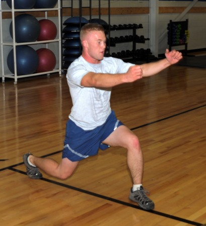
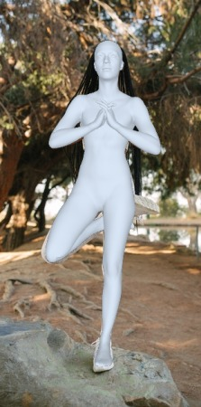
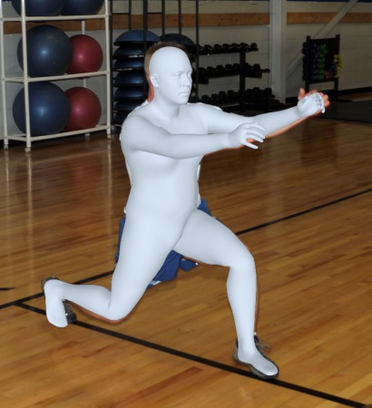
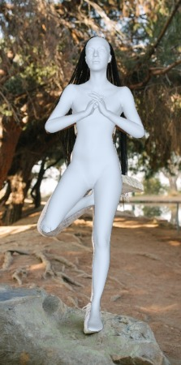

# SAM 3D Body 加速与评测

[English](README.md) · **简体中文**

基于 [Meta SAM 3D Body](https://github.com/facebookresearch/sam-3d-body) 和 [Fast SAM 3D Body](https://github.com/yangtiming/Fast-SAM-3D-Body)，本项目优化单人 3D 人体重建的完整推理路径，并在相同输入上对照不同配置的耗时和输出差异。项目提供可复用的 TensorRT 与编译配置、身体解码执行优化，以及本地适配的 **INT8 384** 骨干。桌面界面用于切换方案、预热和查看对照结果。

在 RTX 4060 Laptop 8 GB 上，**Fast INT8 384 平均完整推理 41.71 ms，P95 43.53 ms**，每次都执行 YOLO。和同批次 **Fast FP16 384** 的 53.99 ms 相比，均值下降约 **23%**。在这组样本上，Fast FP16 512 最接近标准版。Fast INT8 512 的平均耗时为 60.90 ms，网格、骨架和双肘角度与标准版的差异均小于两种 384 方案。

## 方案矩阵

| 身体方案 | 网络输入 | DINOv3 骨干 | 人体检测 | 解码器 / MHR / 中间预测编译 | 姿态预测 |
| --- | --- | --- | --- | --- | --- |
| 标准版身体 | 512 × 512 | Comfy BF16 路径 | 本基准传入固定框 | 关 / 关 / 关 | 标准路径默认 |
| Fast FP16 512（身体 512 对照） | 512 × 512 | TensorRT FP16 | YOLO11m-Pose TensorRT，每次执行 | 开 / 开 / 开 | 3 次 + 最终预测 |
| Fast INT8 512（Embedl） | 512 × 512 | TensorRT INT8/FP16 | 同上 | 开 / 开 / 开 | 3 次 + 最终预测 |
| Fast FP16 384（演示最快） | 384 × 384 | TensorRT FP16 | 同上 | 开 / 开 / 开 | 3 次 + 最终预测 |
| Fast INT8 384（本地实验） | 384 × 384 | TensorRT INT8/FP16 | 同上 | 开 / 开 / 开 | 3 次 + 最终预测 |

分辨率指人体裁剪送入骨干的尺寸。INT8 表示骨干的混合精度执行，表内 Fast 方案的解码器和 MHR 默认保持 FP32。INT8 384 复用了 Embedl 512 的权重与量化尺度，重新生成 384 对应的位置表并适配静态输入，见 [INT8 384 实验](docs/EMBEDL_INT8_384.md)。

| 可配置项 | 支持选项与限制 |
| --- | --- |
| 重建范围 | 标准版 512 或 Fast FP16 512 可选身体、身体＋手部精修。Fast 384 与 Embedl INT8 身体方案限定为身体模式 |
| 骨干和检测器执行器 | Fast 可分别选择 PyTorch 或 TensorRT。Embedl INT8 骨干要求对应分辨率的单人 TensorRT 引擎 |
| 编译 | Fast 的解码器、MHR 和中间预测可分别开关 |
| 身体中间反馈次数 | Fast 身体支持 0、1、2、3 次中间反馈，各自仍执行一次最终预测 |
| 预热 | 可设置 1–30 次，选择上传图、相机尺寸或两种布局。结果记录实际执行配置 |
| Fast 执行优化 | 反馈缓存、中间 MHR70 专用路径、最终预测图重放和身体路径数据搬运优化，可按文档用环境变量关闭做消融 |

配置限制与预设定义见 [launch_config.py](launch_config.py)。独立手部重建使用另一套 512 配置与检测流程，见 [手部加速](docs/HAND_ACCELERATION.md)。

## 完整推理耗时与标准版输出对照

使用 Gemini 336L 录制的同一组 **12 张全身姿态**，保持原始 RGB、标定内参及人体框一致。每方案使用正式 worker，启动预热 10 次，每姿态再预热 3 次、测量 20 次，共 **240 次**。以下均为单人身体模式，关闭独立手部精修、掩膜提示、深度拟合、SMPL 转换和时序滤波。

| 方案 | 平均 / P95（ms） | 平均耗时比（标准版 ÷ 本行） | 对齐网格（mm） | 对齐 127 骨架点（mm） | 相机系网格（mm） | 双肘夹角（°） |
| --- | ---: | ---: | ---: | ---: | ---: | ---: |
| 标准版 BF16 512 | 150.00 / 151.48 | 1.00× | 基准 | 基准 | 基准 | 基准 |
| Fast FP16 512 | 75.98 / 78.18 | 1.97× | 5.590 | 4.274 | 6.444 | 0.677 |
| Fast INT8 512 | 60.90 / 62.83 | 2.46× | 13.817 | 13.401 | 16.246 | 1.280 |
| Fast FP16 384 | 53.99 / 56.46 | 2.78× | 17.452 | 17.790 | 38.611 | 2.070 |
| Fast INT8 384 | **41.71 / 43.53** | **3.60×** | 19.327 | 19.252 | 39.926 | 2.411 |

- **计时范围**为已解码图像进入 worker 后，到 CPU 拿到重建结果。Fast 包含逐次 YOLO、裁剪、网络和结果回传。标准版使用相同的预给检测框，计时从给定框开始，耗时比按此口径计算。全部计时在 CUDA 同步后读取，模型加载、预热、编译、文件读写、相机采集和显示在计时区间之外。
- **精度用标准版一致性衡量。** 对齐距离以骨盆中心消除平移，保留朝向、尺寸与姿态差异。相机系网格距离保留相机平移差异。各列为对应点的欧氏距离或肘角绝对差，按 12 个姿态平均。标准版是 Comfy BF16 512 身体路径的预测参照，真实人体绝对误差和连续动作稳定性需要另行验证。
- **结果按批次记录。** 标准版与 INT8 512 来自 [512 对照](docs/FAST384_VS_INT8_512.md)，两种 384 来自后续 [384 同批测试](docs/EMBEDL_INT8_384.md)，FP16 512 为 2026-11-21 使用同输入、同框和同预热规则的补测。各 worker 顺序运行，历史数字与补测数字用来比较量级。两种 384 的差值来自同一轮。对照脚本见 [compare_backbones_standard.py](scripts/compare_backbones_standard.py) 和 [check_embedl_384.py](scripts/check_embedl_384.py)，指标实现见 [report_standard_reference.py](scripts/report_standard_reference.py)。

## 彩色网格叠加对比

每列是一个公开样例，按上表顺序展示五个方案的实际预测。各方案使用相同的 RGB 和估算相机内参。Fast 逐次执行 YOLO，标准版使用同一人体框。浅蓝色网格使用各自预测的相机平移投影到彩色图上，保留原始姿态与位置差异。点击图片可放大。

| 方案 | 弓步 | 单腿站立 |
| --- | :---: | :---: |
| 原始 RGB | [](docs/images/acceleration-overlays/lunge-rgb.jpg) | [](docs/images/acceleration-overlays/tree-rgb.jpg) |
| 标准版 BF16 512（基准） | [](docs/images/acceleration-overlays/lunge-std512.jpg) | [](docs/images/acceleration-overlays/tree-std512.jpg) |
| Fast FP16 512 | [](docs/images/acceleration-overlays/lunge-fast512.jpg) | [](docs/images/acceleration-overlays/tree-fast512.jpg) |
| Fast INT8 512 | [](docs/images/acceleration-overlays/lunge-int8512.jpg) | [](docs/images/acceleration-overlays/tree-int8512.jpg) |
| Fast FP16 384 | [](docs/images/acceleration-overlays/lunge-fast384.jpg) | [](docs/images/acceleration-overlays/tree-fast384.jpg) |
| Fast INT8 384 | [](docs/images/acceleration-overlays/lunge-int8384.jpg) | [](docs/images/acceleration-overlays/tree-int8384.jpg) |

两张图用于展示投影轮廓，性能与几何一致性指标来自上文的 12 姿态评测。照片来源为 Myles Stepp / U.S. Air Force（美国公共领域）及 BodyBendYoga / Nappy.co（CC0 1.0）。[弓步原图](https://commons.wikimedia.org/wiki/File:Airman_performing_lunge.jpg) · [单腿站立原图](https://commons.wikimedia.org/wiki/File:Woman_yoga_pose.jpg)

## Fast 路径优化

| 优化 | 实现 | Fast FP16 384 完整推理均值（各自同批消融） |
| --- | --- | ---: |
| [反馈缓存与减少复制](docs/FAST_FEEDBACK_CACHE.md) | 在单次解码内复用相同采样和中间数据 | 65.407 → 63.876 ms |
| [中间 MHR70 关键点专用路径](docs/FAST_KEYPOINT_PATH.md) | 只计算关键点需要的几何依赖，单人使用 CUDA Graph | 64.966 → 60.376 ms |
| [最终预测图重放与数据搬运优化](docs/FAST_EXECUTION.md) | 重放完整预测核心，减少同步与 CPU 回传开销 | 57.443 → 53.820 ms |

每行是独立消融，基线随批次与已有优化变化，耗时收益以完整方案实测为准。最终仍生成完整网格。MHR FP16 和混合精度已单独试验，完整推理均值约 41–42 ms，与 FP32 复测处于相同范围，默认保留 FP32。见 [MHR 精度实验](docs/MHR_PRECISION_EXPERIMENT.md)。

## 开始使用

支持环境：Ubuntu、NVIDIA CUDA GPU；本地已在 RTX 4060 Laptop 8 GB 上验证。其他平台／显卡需要自行验证。模型不包含在仓库里。

```bash
git clone https://github.com/hanzibo/sam3d-body-studio.git
cd sam3d-body-studio
cp config/paths.example.json config/local.json
# 按 docs/INSTALL.md 创建环境、获取源码／获授权的模型，填写本机路径
python3 studio_paths.py --doctor
./launch_gui.sh
```

完整步骤见 **[安装与模型准备](docs/INSTALL.md)**、[界面使用说明](gui/使用说明.md)、[RGB-D 实验说明](gui/RGB-D几何验证说明.md)。安装桌面图标：

```bash
python3 scripts/install_desktop.py --desktop
```

默认预设“演示最快”对应 **Fast FP16 384**，需要先构建并登记 FP16 384 骨干和 YOLO TensorRT 引擎。没有引擎时，在预热前选择 Fast 512、骨干／检测器 PyTorch，并关闭三个编译开关进行初次验证，或者使用标准版。TensorRT 引擎构建完成后可在兼容环境中重复加载，按方案预热。

独立采集后续深度实验数据可运行 `./launch_rgbd_recorder.sh`。支持彩色／深度预览、倒计时、多姿态自动拍摄、重拍与续采；连续 RGB-D 录制支持自定义命名、动作提示和逐帧时间戳，采集期间不加载模型。见 [RGB-D 记录工具](docs/RGBD_RECORDER.md)。

## 目录与数据

| 路径 | 用途 | 是否发布 |
| --- | --- | --- |
| `gui/`、根目录 Python／启动脚本 | 界面、隔离推理、采集和评估 | 是 |
| `docs/`、`requirements/`、`dependencies.json`、`scripts/`、`tests/` | 文档、依赖版本、部署及验证 | 是 |
| `third_party/` | 按固定提交获取上游源码 | 否 |
| `models/`、`assets/smpl/` | 权重、TensorRT 引擎、授权 SMPL 模型 | 否 |
| `config/local*.json` | 本机解释器／源码／资产路径、引擎校验记录 | 否 |
| `config/gemini336l_rgb.json` | 可选固定相机标定；照片元数据优先 | 否 |
| `outputs/`、`profiles/`、缓存、日志 | 照片、RGB-D、历史、录制、用户方案 | 否 |

应用不会上传图片。运行产物默认保留在本地 `outputs/`；手动导出到仓库外的数据需自行管理。不要用 `git add -f` 添加模型或真人数据。

第四个标签页“数据管理”支持分类统计、搜索、目录 / 图片 / 文本预览，以及将完整样本或运行移入系统回收站；当前任务及正在使用的数据受保护。各目录内容、删除边界与恢复方法见 [数据管理说明](docs/DATA_MANAGEMENT.md)。

## 运行检查

```bash
python3 -m unittest discover -s tests -v
# 以下两个测试需要 requirements/gui.txt 中的数值依赖
python test_fast_selection.py
python mhr_filter_test.py
# 可选 RGB-D 渲染检查：还需 pyrender 和可用的 EGL/OpenGL
python rgbd_geometry_test.py
```

环境与功能验证见 [验证记录](docs/VALIDATION.md)。持续集成检查源码编译与无模型测试；真实推理使用 `python scripts/check_inference.py --backend standard` 或 `--backend fast`，需要本地模型和 CUDA。GUI 与相机交互说明见安装文档。

## 对照工具

- [桌面界面](gui/使用说明.md)支持静态图、相机实时流、彩色叠加和 3D 网格预览。支持骨架、几何关节角、可选 SMPL 转换及滤波，并保存配置、运行历史与原始／滤波动作数据。
- [RGB-D 几何验证](gui/RGB-D几何验证说明.md)用标定内参与深度构造点云，可用同一组姿态对照多种方案的可见表面一致性。另有 [深度拟合](docs/DEPTH_REFINEMENT.md)、[连续跟踪实验](docs/RGBD_TRACKING_EXPERIMENT.md)和[同帧对照](docs/RGBD_THREE_METHOD_COMPARISON.md)。
- [手部实验](docs/HAND_LAB.md)支持单／双手检测、独立重建、实时预览和导出。[MHR 实验室](gui/使用说明.md)可导入人体预测并编辑参数。
- [离线视频](docs/VIDEO.md)支持多人分段提示与逐帧重建。[SAM3 掩膜提示](docs/MASK_PROMPTS.md)支持点选分割和掩膜膨胀／腐蚀，分割和人体推理分阶段使用显存。

## 致谢与引用

- [SAM 3D Body 项目](https://github.com/facebookresearch/sam-3d-body)，[论文](https://arxiv.org/abs/2602.15989)：人体重建模型与基本推理流程。
- [Fast SAM 3D Body 项目](https://github.com/yangtiming/Fast-SAM-3D-Body)，[主页](https://yangtiming.github.io/Fast-SAM-3D-Body-Page/)，[论文](https://arxiv.org/abs/2603.15603)：加速推理及 MHR→SMPL／平滑模块。
- [Embedl SAM 3D Body](https://huggingface.co/embedl/sam-3d-body) 提供 DINOv3 INT8 量化导出。
- [Momentum Human Rig (MHR)](https://github.com/facebookresearch/MHR)：参数化人体表示；[ComfyUI](https://github.com/Comfy-Org/ComfyUI)：标准推理适配；[SAM3](https://github.com/facebookresearch/sam3)：可选人体分割。
- [Orbbec SDK](https://github.com/orbbec/pyorbbecsdk) 与 [Gemini 336L Python 示例](https://github.com/hanzibo/orbbec-gemini-336l-python-examples)：相机采集接口与实践参考。

原论文 BibTeX 已按两个上游 README 整理至 [CITATIONS.bib](CITATIONS.bib)。研究中使用本项目时，请同时引用所用的原模型和上游加速方法。

## 许可证

本仓库原创的 Studio 集成代码默认采用 **GPL-3.0-only**，见 [LICENSE](LICENSE)，文件头另有声明的除外。`calibrated_visualization.py` 改写自官方渲染代码，按 **SAM License** 标注；ComfyUI 加载器及 Fast 转换流程的改写来源也已单独声明。第三方权重、数据和人体资产不随本仓库发布，本许可证不重新授权这些内容。

**许可审查尚有未决项：** GPL、SAM／DINOv3 自定义许可及可选 AGPL 组件的组合分发尚未确认兼容；分进程、单独下载和补齐署名不能自动解决这些问题。不要将整个运行栈理解为已确认可统一 GPL 发布或商业交付。逐项依据、已完成的修正和后续需要确认的授权，见 [许可证与来源审查](docs/LICENSE_AUDIT.md)、[逐文件清单](docs/provenance.json) 和 [第三方说明](THIRD_PARTY_NOTICES.md)。
